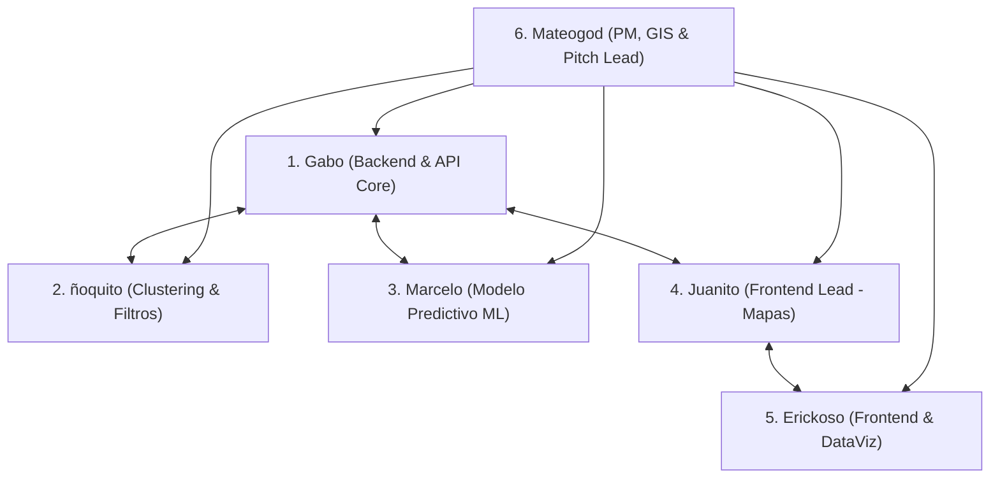

# FuegoClaro — Guía Operativa de Equipo y Plan de Implementación

Documento oficial de coordinación y ejecución técnica para el proyecto **FuegoClaro** (*NASA Space Apps — Harmonization of MODIS and VIIRS Hot Spots*, Ecuador).

---

## 1. Problema que Resuelve el Proyecto

### A. Contexto
La NASA provee datos satelitales en tiempo casi real de anomalías térmicas a través de **FIRMS** (*Fire Information for Resource Management System*) mediante dos sensores: **MODIS** y **VIIRS**. 

### B. Problemáticas Específicas
1. **Incompatibilidad Científica entre Sensores (MODIS vs. VIIRS):**
   * **Resolución espacial disímil:** MODIS tiene un tamaño de píxel de **1 km**, mientras que VIIRS detecta a **375 m**. VIIRS captura fuegos mucho más pequeños y genera muchas más detecciones para un mismo evento.
   * **Escalas de confianza incompatibles:** MODIS entrega un porcentaje numérico continuo (0–100), mientras que VIIRS entrega categorías discretas (`low`, `nominal`, `high`).
   * **Error común:** Sumar o comparar directamente conteos de ambos sensores como si fueran equivalentes o indicaran hectáreas quemadas. FuegoClaro los armoniza canónicamente bajo una taxonomía común sin distorsionar los datos originales.
2. **Falta de Contexto Territorial y Temporal en Ecuador:**
   * Los datos globales vienen en coordenadas crudas y hora universal UTC.
   * El proyecto los delimita, los cruza con la división provincial y regiones naturales de Ecuador (Costa, Sierra, Oriente, Galápagos) y los ajusta a los husos horarios locales (**UTC-5** continental y **UTC-6** insular).
3. **Confusión Pública y Falsos Positivos:**
   * Una detección satelital **no equivale** automáticamente a un incendio forestal confirmado ni a superficie quemada (puede ser una quema de rastrojo agrícola de 1 hora, un mechero petrolero o un tejado metálico caliente).
   * La ausencia de detecciones tampoco garantiza ausencia de fuego (humo denso, nubosidad o la órbita del satélite pueden ocultarlo).

---

## 2. Las Dos Mejoras Clave a Implementar

### Mejora 1: Identificación y Clustering de Incendios Reales (ñoquito)
Diferenciar anomalías térmicas aisladas/menores de **incendios forestales críticos**.
* **Parámetros FIRMS clave:** FRP (*Fire Radiative Power* en MW), temperatura de brillo diferencial, paso diurno vs. nocturno (`daynight == 'N'` es señal crítica de incendio fuera de control) y nivel de confianza.
* **Agrupamiento espaciotemporal (DBSCAN):** Agrupar puntos cercanos en el espacio y en el tiempo para delimitar polígonos de incendios reales.
* **Filtros contextuales:** Máscara para excluir mecheros petroleros fijos en la Amazonía (Orellana/Sucumbíos) y cruce con áreas protegidas (SNAP).

### Mejora 2: Modelo Predictivo de Susceptibilidad a Incendios (Marcelo)
Pasar de un enfoque reactivo (apagar cuando ya hay fuego) a un enfoque preventivo (identificar zonas propensas antes de la ignición).
* **Modelo supervisado:** Random Forest o LightGBM entrenado con el histórico de incendios en Ecuador (2022–2026).
* **Variables predictoras:** Topografía (pendiente/elevación DEM), meteorología (temperatura máx, humedad relativa, viento, sequía acumulada), vegetación (NDVI) y factor humano (distancia a vías y poblados).
* **Salida:** Mapa de calor / semáforo de riesgo (Bajo, Medio, Alto, Extremo) por cantón.

---

## 3. Asignación de Roles y Tareas Específicas por Integrante

---

### 👤 Persona 1: Gabo — Backend & Ingestion Lead (Arquitectura & API)
* **Objetivo:** Ser el corazón de integración de datos del proyecto, asegurando que el backend procese y sirva los datos limpios a través de una API REST rápida y documentada.

#### Tareas Específicas:
- [ ] **Configuración del entorno:** Levantar y validar FastAPI y Docker Compose (`docker-compose.yml`, `backend/Dockerfile`).
- [ ] **Definir contratos de datos temprano (Hora 1-2):** Acordar los JSON de respuesta con Juanito y Erickoso para que puedan trabajar con mocks sin esperar a la lógica final.
- [ ] **Endpoints REST a construir y exponer:**
  - `GET /api/v1/detections`: Filtros por `start_date`, `end_date`, `province`, `sensor`, `confidence`.
  - `GET /api/v1/fire-events`: Servir los eventos/clusters procesados por ñoquito (polígonos, FRP total, severidad).
  - `GET /api/v1/susceptibility`: Servir el mapa de riesgo cantonal/provincial calculado por Marcelo.
  - `GET /api/v1/analytics/summary`: Métricas agregadas para los gráficos de Erickoso.
- [ ] **Integración de código:** Recibir los módulos Python de ñoquito (`clustering.py`) y Marcelo (`prediction.py`) e integrarlos en el pipeline de FastAPI.
- [ ] **Validación:** Implementar esquemas Pydantic y asegurar que no haya errores de CORS con el frontend.

---

### 👤 Persona 2: ñoquito — Data Scientist (Clustering & Identificación de Incendios)
* **Objetivo:** Transformar puntos térmicos sueltos en "Eventos de Incendio Confirmados" mediante clustering y descarte de falsos positivos.

#### Tareas Específicas:
- [ ] **Algoritmo de Clustering (ST-DBSCAN / DBSCAN):**
  - Implementar en Python (`scikit-learn` o `scipy`) un agrupador de coordenadas geográficas (`lat`, `lon`) con ventana temporal (24-48h). Radio espacial sugerido: $1.5\text{ a }2\text{ km}$.
- [ ] **Cálculo de métricas por cluster:**
  - `frp_total`: Suma de FRP de todos los puntos del cluster.
  - `frp_max`: Pico máximo de potencia registrado.
  - `puntos_count`: Cantidad de detecciones agrupadas.
  - `geometria`: Convex Hull (polígono envolvente) o Bounding Box del incendio.
- [ ] **Motor de reglas de clasificación:**
  - **Alerta Roja / Crítica:** $FRP_{total} > 100\text{ MW}$ O detección activa en paso nocturno (`daynight == 'N'`).
  - **Alerta Media:** $FRP$ moderado en vegetación nativa/páramo.
  - **Quema Menor / Agrícola:** Puntos individuales de bajo FRP en áreas de cultivo diurnas.
- [ ] **Filtro de falsos positivos industriales:**
  - Excluir coordenadas fijas de mecheros petroleros en Orellana y Sucumbíos (usar la lista provista por Mateogod).
- [ ] **Entregable:** Función modular `detect_fire_events(df_detections) -> list[dict]` lista para que Gabo la importe en la API.

---

### 👤 Persona 3: Marcelo — ML Engineer (Modelo Predictivo de Susceptibilidad)
* **Objetivo:** Entrenar un modelo de Machine Learning que determine qué zonas de Ecuador tienen alto riesgo de presentar incendios.

#### Tareas Específicas:
- [ ] **Construcción del Dataset de Entrenamiento:**
  - Nivel de agregación: Cantonal o celdas de cuadrícula ($0.05^\circ \times 0.05^\circ$).
  - **Variable Target ($Y$):** Ocurrencia de incendio histórico ($1 = \text{sí}$, $0 = \text{no}$) usando FIRMS 2022–2026.
  - **Variables Predictoras ($X$):**
    - Topografía: Pendiente media y elevación (DEM SRTM o Copernicus).
    - Clima: Temperatura máxima, humedad relativa, velocidad de viento, días sin lluvia (Open-Meteo API / ERA5).
    - Vegetación: Cobertura vegetal (páramo, bosque, pastizal) o NDVI medio.
    - Factor humano: Distancia a carreteras o densidad poblacional.
- [ ] **Entrenamiento del Modelo:**
  - Entrenar un clasificador en `scikit-learn` (**Random Forest** o **LightGBM**).
  - Evaluar métricas (AUC-ROC, F1-Score, Matriz de Confusión).
- [ ] **Generación del Índice de Riesgo:**
  - Obtener la probabilidad de riesgo predicha ($0.0\text{ a }1.0$) y categorizar: Bajo ($<0.3$), Medio ($0.3–0.6$), Alto ($0.6–0.8$), Extremo ($>0.8$).
- [ ] **Entregable:**
  - Archivo GeoJSON o diccionario cantonal con los scores de riesgo actuales.
  - Script de inferencia o modelo guardado (`model.joblib`) listo para que Gabo lo exponga en `/api/v1/susceptibility`.

---

### 👤 Persona 4: Juanito — Frontend Lead (Mapas Interactivos & Experiencia Espacial)
* **Objetivo:** Construir la experiencia visual principal: un mapa interactivo de Ecuador fluido, claro y de alto impacto visual.

#### Tareas Específicas:
- [ ] **Setup del mapa interactivo:**
  - Configurar mapa base en React (Leaflet o MapLibre GL) centrado en Ecuador (`lat: -1.83, lon: -78.18`, zoom 7) con soporte para Galápagos y continente.
  - Mapas base: Satelital oscuro (Dark Matter / CARTO o ESRI Satellite).
- [ ] **Implementar Capa 1 — Focos Térmicos Individuales:**
  - Renderizar detecciones individuales diferenciando con íconos o colores el sensor: **MODIS** vs. **VIIRS**.
  - Filtrar por opacidad según el nivel de confianza (baja, nominal, alta).
- [ ] **Implementar Capa 2 — Eventos de Incendio (Clusters de ñoquito):**
  - Dibujar los polígonos/burbujas de los clusters con tamaño proporcional al FRP total y color según severidad (Rojo = Crítico, Naranja = Medio, Amarillo = Bajo).
  - Popups interactivos al hacer clic: Nombre del evento, provincia, FRP total, cantidad de focos, hora local estimada.
- [ ] **Implementar Capa 3 — Mapa de Susceptibilidad (Modelo de Marcelo):**
  - Capa de coropletas por cantón coloreada según el nivel de riesgo predicho (Verde $\rightarrow$ Amarillo $\rightarrow$ Rojo intenso).
- [ ] **Controles espaciales:**
  - Selector de capas (conmutar individualmente cada capa).
  - Slider de fecha/tiempo o botón de reproducción para ver la evolución de un incendio.

---

### 👤 Persona 5: Erickoso — Frontend & DataViz (Dashboard, Filtros & Alertas)
* **Objetivo:** Crear el centro de mando analítico que dé contexto, métricas y valor para la toma de decisiones.

#### Tareas Específicas:
- [ ] **Centro de Mando / Feed de Alertas Críticas:**
  - Panel lateral con la lista de incendios activos en tiempo real ordenados por severidad.
  - Cada tarjeta debe incluir: Provincia/Cantón, FRP total, badge de urgencia (Crítico/Moderado) y un botón interactivo *"Ver en mapa"* que haga zoom en la coordenada del mapa de Juanito.
- [ ] **Gráficos analíticos interactivos (Recharts / Chart.js):**
  - **Comparativa MODIS vs VIIRS:** Gráfico de barras/líneas mostrando el desfase de detecciones entre ambos sensores en el tiempo.
  - **Curva de estacionalidad:** Gráfico de calor mensual/semanal mostrando los meses históricamente más peligrosos en Ecuador (agosto - noviembre).
  - **Distribución provincial:** Gráfico de barras con las provincias con mayor número de eventos.
- [ ] **Filtros globales reactivos:**
  - Selector de rango de fechas.
  - Dropdown multiselect de provincias (Pichincha, Loja, Guayas, Imbabura, etc.).
  - Filtro por sensor y nivel de confianza.
- [ ] **Tarjetas de KPIs principales en el header:**
  - Total focos detectados | Incendios críticos confirmados | Cantones en riesgo extremo.
- [ ] **Pulido estético:** Aplicar diseño moderno en modo oscuro con Tailwind CSS.

---

### 👤 Persona 6: Mateogod — PM, GIS Data & Pitch Lead
* **Objetivo:** Guiar el producto, suministrar capas geográficas clave, validar con casos reales y liderar la presentación ganadora ante los jueces.

#### Tareas Específicas:
- [ ] **Insumos GIS para el equipo (Horas 1–3):**
  - Descargar y limpiar GeoJSON de límites provinciales y cantonales de Ecuador (INEC / Natural Earth). Entregar a Gabo, Juanito y Marcelo.
  - Obtener el shapefile/GeoJSON del SNAP (Sistema Nacional de Áreas Protegidas del Ecuador).
  - Recopilar coordenadas aproximadas de mecheros de gas en Orellana y Sucumbíos para la lista negra de ñoquito.
- [ ] **Validación con casos reales de Ecuador (Horas 4–12):**
  - Investigar los datos históricos oficiales de los dos grandes incendios de 2024:
    1. **Incendio de Quilanga (Loja) — Agosto/Septiembre 2024** (>7,000 hectáreas quemadas).
    2. **Incendio de Guápulo / Parque Metropolitano (Quito) — Septiembre 2024**.
  - Probar con el equipo si la plataforma refleja estos eventos correctamente en fecha, ubicación y severidad.
- [ ] **Storytelling y Pitch Deck (Horas 13–19):**
  - Estructurar las diapositivas:
    1. *Problema:* El caos de los incendios en Ecuador 2024 y la desinformación con datos satelitales crudos.
    2. *Solución FuegoClaro:* Armonización MODIS/VIIRS + Clustering inteligente + Modelo predictivo preventivo.
    3. *Demo en Vivo:* Mostrar la detección de eventos y el mapa de riesgo cantonal.
    4. *Impacto y Viabilidad:* Ahorro de recursos para Bomberos/SGR y protección de fuentes hídricas en páramos.
- [ ] **Contingencia y Entrega (Horas 20–24):**
  - Grabar un video demo de 2 minutos (por si falla el internet durante la presentación).
  - Coordinar el ensayo de la presentación cronometrada y revisar la documentación final.

---

## 4. Cronograma de Integración por Fases (24 Horas)

| Horario | Fase | Entregable Clave | Responsables |
| :---: | :--- | :--- | :--- |
| **H 00 – 03** | **Fase 1: Contratos & GIS** | Contratos de API acordados. Mateogod entrega capas GeoJSON. Gabo levanta mock de endpoints. | Todos |
| **H 04 – 12** | **Fase 2: Construcción Paralela** | ñoquito termina DBSCAN. Marcelo entrena el modelo base. Juanito monta mapa base. Erickoso maqueta dashboard. | Trabajo individual |
| **H 13 – 17** | **Fase 3: Integración Backend** | Gabo conecta el clustering de ñoquito y el modelo de Marcelo a FastAPI. Frontend empieza a consumir API real. | Gabo, ñoquito, Marcelo |
| **H 18 – 20** | **Fase 4: Integración UI & Casos Reales** | Juanito y Erickoso conectan todas las capas y gráficos. Mateogod valida los incendios de Quilanga y Guápulo 2024. | Juanito, Erickoso, Mateogod |
| **H 21 – 22** | **Fase 5: Testing & Pulido** | Corrección de bugs visuales, filtros y tiempos de carga. Congelamiento de código. | Todos |
| **H 23 – 24** | **Fase 6: Pitch, Video & Entrega** | Grabación de video de respaldo, ensayo de pitch cronometrado y entrega en la plataforma. | Mateogod y equipo |

---

## 5. El "Discurso Ganador" para el Pitch ante los Jueces

1. **Apertura de alto impacto:**  
   *"En septiembre de 2024, Ecuador vivió una de sus peores olas de incendios en Loja y Quito. Los servicios de emergencia estaban colapsados y la ciudadanía confundida por mapas con puntos rojos que no distinguían un incendio real de una quema de rastrojo de 15 minutos."*
2. **Nuestra propuesta de valor:**  
   *"FuegoClaro no es solo un visor satelital: es un sistema integral de triaje y predicción. Armonizamos la física dispar de los satélites MODIS y VIIRS, agrupamos detecciones para medir potencia real en megavatios (FRP) y predecimos qué cantones están a punto de arder antes de que caiga la primera chispa."*
3. **La prueba irrefutable (Demo):**  
   *"Miren Quilanga en agosto de 2024: mientras otros veían puntos dispersos, nuestro algoritmo detectó el cluster crítico activo a las 2 a.m. con más de 300 MW, y nuestro modelo de riesgo ya situaba a Loja en Alerta Extrema 48 horas antes."*
4. **Cierre:**  
   *"Protegemos a las comunidades, optimizamos el presupuesto de los bomberos y resguardamos los páramos que nos dan agua potable. Con FuegoClaro, la ciencia satelital de la NASA salva vidas en Ecuador."*
