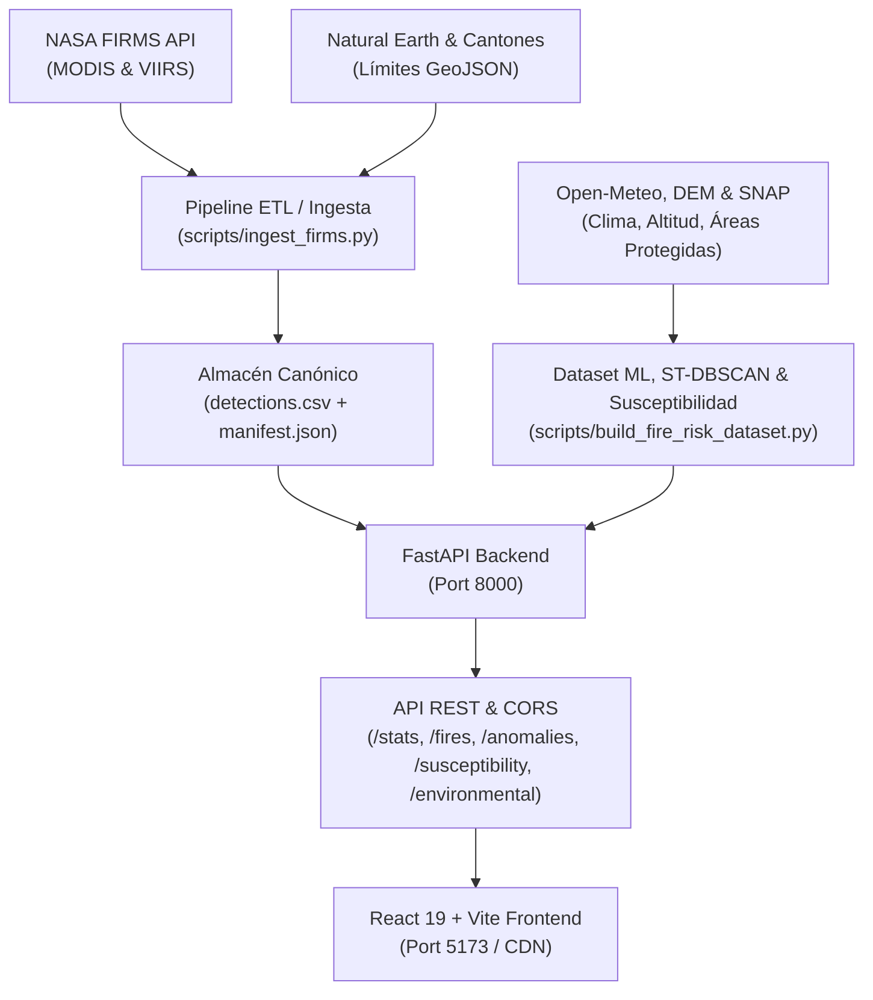

# FuegoClaro 🔥🛰️

[](https://www.spaceappschallenge.org/)
[](LICENSE)
[](https://github.com/Jdquimbiulco/FuegoClaro/releases)
[](https://fuegoclaro-frontend.onrender.com)
[](https://fuegoclaro-backend.onrender.com/api/v1/health)

> **Plataforma de armonización, exploración, alertas ambientales y análisis predictivo de focos de calor satelitales (NASA FIRMS MODIS & VIIRS) en Ecuador.**  
> *Desarrollado para el reto oficial de NASA Space Apps Challenge 2026: Harmonization of MODIS and VIIRS Hot Spots.*

---

## 🌐 Enlaces en Vivo / Live Deployments

| Componente | URL de Producción | Estado |
|---|---|:---:|
| 💻 **Frontend Web (React + Vite)** | **[https://fuegoclaro-frontend.onrender.com](https://fuegoclaro-frontend.onrender.com)** |  |
| 🛰️ **Backend REST API (FastAPI)** | **[https://fuegoclaro-backend.onrender.com](https://fuegoclaro-backend.onrender.com)** |  |
| 🩺 **Endpoint de Salud / Healthcheck** | **[https://fuegoclaro-backend.onrender.com/api/v1/health](https://fuegoclaro-backend.onrender.com/api/v1/health)** |  |

---

## 📑 Tabla de Contenidos / Table of Contents
- [Español](#-versión-en-español)
  - [Aviso Científico y Responsabilidad](#-aviso-científico-y-responsabilidad)
  - [¿Qué es FuegoClaro?](#-qué-es-fuegoclaro)
  - [Características Principales](#-características-principales)
  - [Arquitectura del Sistema](#-arquitectura-del-sistema)
  - [Reproducibilidad con Docker](#-reproducibilidad-y-ejecución-rápida-con-docker)
  - [Fuentes de Datos y Atribución](#-fuentes-de-datos-y-atribución)
  - [Declaración de Uso de Inteligencia Artificial](#-declaración-de-uso-de-inteligencia-artificial)
  - [Equipo de Desarrollo](#-equipo-de-desarrollo)
- [English Version](#-english-version)
  - [Scientific Disclaimer](#-scientific-disclaimer)
  - [About FuegoClaro](#-about-fuegoclaro)
  - [Key Features](#-key-features)
  - [System Architecture](#-system-architecture)
  - [Docker Quickstart](#-docker-quickstart)
  - [Data Sources & Attribution](#-data-sources--attribution)
  - [AI Usage Declaration](#-ai-usage-declaration)
  - [License](#-license)

---

# 🇪🇸 Versión en Español

## ⚠️ Aviso Científico y Responsabilidad

1. **Una detección térmica no es un incendio confirmado:** Un píxel térmico (*hotspot*) representa una anomalía infrarroja en superficie detectada por el sensor en el momento del sobrevuelo (fuego activo, quema agrícola, chimenea industrial, suelo recalentado). No mide de forma directa la superficie quemada ni confirma un incendio forestal sin validación de campo.
2. **La ausencia de detección no implica ausencia de fuego:** La cobertura nubosa densa, el humo espeso, copas arbóreas cerradas o fuegos de baja intensidad entre los horarios de órbita pueden impedir la detección satelital.
3. **No comparar conteos brutos entre sensores:** **MODIS (~1 km de resolución espacial)** y **VIIRS (~375 m)** poseen sensibilidades, coberturas y algoritmos completamente distintos. VIIRS detecta fuegos significativamente más pequeños y produce entre 3× y 5× más detecciones en la misma zona. FuegoClaro **armoniza y contextualiza** estas diferencias respetando la confianza nativa de cada instrumento.

---

## 🌟 ¿Qué es FuegoClaro?

**FuegoClaro** es una solución científica e interactiva para el monitoreo y análisis de anomalías térmicas en el territorio ecuatoriano (sus 24 provincias, 4 regiones naturales y cantones, incluyendo Galápagos).

El sistema ingesta más de **116.000 detecciones históricas y en tiempo casi real de NASA FIRMS (2022–2026)**, aplicando un pipeline de normalización territorial, detección estadística de anomalías (z-score + control de tasa de falso descubrimiento FDR Benjamini–Hochberg), clustering espaciotemporal de eventos de incendio (ST-DBSCAN), cruce de alertas con **Áreas Protegidas del SNAP**, y un **modelo predictivo de Machine Learning** para generar mapas de susceptibilidad a horizontes de 0 a 7 días.

---

## 🚀 Características Principales

- 🗺️ **Filtro Jerárquico Territorial y Cantonal:**
  - Filtrado integral a nivel de **País (Ecuador)**, **4 Regiones Naturales** (Costa, Sierra, Amazonía, Galápagos), **24 Provincias** y **Cantones** mediante polígonos GeoJSON oficiales.
- 🛡️ **Alertas Ambientales y Áreas Protegidas (SNAP):**
  - Módulo de alerta temprana que cruza anomalías térmicas en tiempo real con reservas ecológicas, parques nacionales protegidos y mecheros petroleros para priorizar ecosistemas vulnerables.
- 🔮 **Mapas de Susceptibilidad y Riesgo Predictivo (ML a 0–7 días):**
  - Predicción espacial de riesgo por celda de 0.1° × día (artefactos GeoJSON para horizontes de hoy, 24h, 72h y 7 días), combinando clustering ST-DBSCAN con clima (Open-Meteo) y topografía (DEM).
- 🛰️ **Telemetría Orbital y Armonización MODIS vs VIIRS:**
  - Selector bimodal de sensores, filtrado por calidad algorítmica de confianza NASA (baja, nominal, alta) y análisis de potencia radiativa de fuego (FRP en MW) sin inventar scores artificiales.
- 🗺️ **Cartografía Multicapa con Esri Basemaps:**
  - Mapas interactivos sin marcas de agua (*Oscuro Canvas*, *Satélite de Alta Resolución* y *Relieve Topográfico*), con agrupamiento dinámico de calor radiante (*MarkerClusters*) y popups detallados.
- 📊 **Radar Estadístico de Anomalías y Hallazgos:**
  - Detección rigurosa de desviaciones térmicas respecto a líneas base históricas de 4 años, con z-score y ajuste FDR Benjamini–Hochberg para eliminar falsas alarmas estadísticas.
- 📅 **Calendario Fenológico y Eventos de Incendio:**
  - Vista mensual por día solar local (UTC-5 continental, UTC-6 Galápagos) y agregación de detecciones en eventos coherentes (`/fire-events`).

---

## 🏗️ Arquitectura del Sistema



- **Backend:** FastAPI, Python 3.12, Pandas, NumPy, Scikit-Learn, Shapely, Uvicorn.
- **Frontend:** React 19, TypeScript, Vite, Tailwind CSS, Leaflet, React-Leaflet, Recharts, Lucide Icons.
- **Despliegue e Infraestructura:** Contenedores Docker, CI/CD con GitHub Actions y Render Blueprints (`render.yaml`).

---

## 🐳 Reproducibilidad y Ejecución Rápida con Docker

La forma más rápida y reproducible de correr FuegoClaro localmente con un solo comando:

```bash
# 1. Clonar el repositorio
git clone https://github.com/Jdquimbiulco/FuegoClaro.git
cd FuegoClaro/Hackaton

# 2. Levantar toda la pila (Backend + Frontend)
docker compose up --build
```

- **Frontend:** Abre tu navegador en [http://localhost:5173](http://localhost:5173)
- **Backend API:** Consulta la API en [http://localhost:8000/api/v1/health](http://localhost:8000/api/v1/health)
- **Documentación Swagger interactiva:** [http://localhost:8000/docs](http://localhost:8000/docs)

*(Para la configuración manual paso a paso sin Docker, consulta [`Hackaton/GUIA_DE_INICIO.md`](Hackaton/GUIA_DE_INICIO.md)).*

---

## 📊 Fuentes de Datos y Atribución

| Recurso | Proveedor / Fuente | Uso en FuegoClaro |
|---|---|---|
| **Detecciones Térmicas** | [NASA FIRMS](https://firms.modaps.eosdis.nasa.gov/) | Focos de calor MODIS (Collection 6.1) y VIIRS (375 m NOAA-20), en productos SP y NRT. |
| **Límites Administrativos** | [Natural Earth (1:10m)](https://www.naturalearthdata.com/) e IGM | Geometrías de las 24 provincias, regiones naturales y cantones de Ecuador. |
| **Mapas Base (Cartografía)** | [Esri Basemaps](https://www.esri.com/) / OpenStreetMap | Capas base Dark Canvas, World Imagery y World Topo Map. |
| **Áreas Protegidas** | SNAP / Ministerio del Ambiente de Ecuador (MAATE) | Identificación de riesgo sobre reservas ecológicas y mecheros petroleros. |
| **Meteorología y DEM** | Open-Meteo & NASA SRTM | Factores climáticos de sequía y altitud para el modelo de riesgo ML. |

*Aviso de atribución: Este proyecto utiliza datos abiertos de la NASA pero no es un producto oficial de la NASA ni cuenta con su patrocinio directo.*

---

## 🤖 Declaración de Uso de Inteligencia Artificial

En cumplimiento con la política de transparencia de NASA Space Apps Challenge:
- **Asistencia en Desarrollo y Código:** Se utilizaron herramientas de IA basadas en modelos de lenguaje (Google Antigravity / Gemini) como copiloto de programación para acelerar la estructuración de tipos en TypeScript, optimización de consultas vectoriales y documentación de código.
- **Modelado Científico:** El módulo predictivo utiliza algoritmos de Machine Learning tradicionales y deterministas (*HistGradientBoostingClassifier* y *ST-DBSCAN* espaciotemporal).
- **Integridad de Datos:** **Ningún dato satelital, foco de calor o coordenada geográfica fue generado artificialmente por IA.** Todas las observaciones corresponden estrictamente a registros verificables de NASA FIRMS.

---

## 👥 Equipo de Desarrollo

Proyecto desarrollado con dedicación por:
- **Juan Diego Quimbiulco** (`@Jdquimbiulco`) — Arquitectura Frontend, Integración UX/UI, Despliegue CI/CD y Mapas.
- **Erick Obando** (`@Tenkenoz`) — Lógica de Dominio, Ingesta y Modelos.
- **Gabriel López** (`@GabMlopez`) — Endpoints API REST y Contratos de Datos.
- **Marcelo** — Evaluación, Checklists de Calidad y Pipeline de Machine Learning.
- **Mateo** — GeoJSON, Análisis Espacial y Áreas Protegidas.
- **Alexander** — Pruebas y Validación de Datos.

---

# 🇺🇸 English Version

## ⚠️ Scientific Disclaimer

1. **A thermal detection is NOT a confirmed fire:** A thermal pixel (*hotspot*) represents an infrared surface anomaly detected during an orbital overpass (active fire, agricultural burn, industrial flare, high surface reflection). It does not directly quantify burned area or confirm an uncontrolled wildfire without ground verification.
2. **Absence of detection does not guarantee absence of fire:** Heavy cloud cover, dense smoke plumes, thick tree canopies, or short-lived fires occurring between satellite passes can obscure surface thermal signatures.
3. **Never compare raw counts between sensors as equivalent:** **MODIS (~1 km spatial resolution)** and **VIIRS (~375 m)** feature fundamentally different optical physics, pixel footprints, and detection algorithms. VIIRS detects fires an order of magnitude smaller, generating 3× to 5× more detections over the same geographic area. FuegoClaro **harmonizes and contextualizes** these instruments without inventing arbitrary unified scores.

---

## 🌟 About FuegoClaro

**FuegoClaro** is an open-source platform created for the **NASA Space Apps Challenge 2026** under the *Harmonization of MODIS and VIIRS Hot Spots* challenge.

It ingests over **116,000 satellite thermal detections across Ecuador (2022–2026)**, providing a scientific pipeline that performs territorial attribution across Ecuador's 24 provinces and cantons, environmental alerts cross-referencing National Protected Areas (SNAP), statistical anomaly detection (z-score + Benjamini–Hochberg False Discovery Rate control), and a **machine learning wildfire susceptibility model** (ST-DBSCAN clustering + Gradient Boosting) spanning forecasting horizons from 0 to 7 days.

---

## 🚀 Key Features

- 🗺️ **Hierarchical Provincial & Cantonal Territorial Filtering:**
  - Deep-dive filtering across Country, 4 Natural Regions, 24 Provinces, and **Cantons** backed by official boundary GeoJSONs.
- 🛡️ **Environmental Alerts & Protected Wilderness (SNAP):**
  - Real-time cross-referencing between satellite hotspots, ecological reserves, national parks, and oil flares to prioritize vulnerable ecosystems.
- 🔮 **Multi-Horizon Wildfire Susceptibility & Predictive ML (0–7 Days):**
  - 0.1° daily grid risk predictions (spatial GeoJSON layers for horizons h0, h1, h3, h7) combining ST-DBSCAN spatial clustering with weather variables (Open-Meteo) and elevation (DEM).
- 🛰️ **Orbital Telemetry & MODIS vs. VIIRS Harmonization:**
  - Multi-sensor selection, NASA algorithmic confidence filtering (low, nominal, high), and Fire Radiative Power (FRP in MW) distribution analysis without arbitrary unified scores.
- 🗺️ **Unwatermarked Multi-Basemap Interactive Cartography:**
  - Clean Esri layers (*Dark Canvas*, *High-Resolution Satellite*, *Topographic Terrain*) with radiant heat marker clusters.
- 📊 **Statistical Anomaly Radar & Verifiable Findings:**
  - Baseline-calibrated deviation detection with z-score and Benjamini–Hochberg FDR control to filter out statistical noise.
- 📅 **Solar-Day Calendar & Fire Event Clustering:**
  - Monthly heat maps calibrated to Ecuadorian local time (UTC-5 continental, UTC-6 Galápagos) and spatiotemporal event aggregation (`/fire-events`).

---

## 🏗️ System Architecture

- **Backend:** FastAPI, Python 3.12, Pandas, NumPy, Scikit-Learn, Shapely, Uvicorn.
- **Frontend:** React 19, TypeScript, Vite, Tailwind CSS, Leaflet, React-Leaflet, Recharts.
- **Infrastructure:** Docker, Automated CI with GitHub Actions, Continuous Deployment on Render (`render.yaml`).

---

## 🐳 Docker Quickstart

To run the entire stack locally with a single command:

```bash
git clone https://github.com/Jdquimbiulco/FuegoClaro.git
cd FuegoClaro/Hackaton
docker compose up --build
```

- **Web App:** Visit [http://localhost:5173](http://localhost:5173)
- **API Health:** Visit [http://localhost:8000/api/v1/health](http://localhost:8000/api/v1/health)
- **Interactive Swagger Docs:** Visit [http://localhost:8000/docs](http://localhost:8000/docs)

---

## 📊 Data Sources & Attribution

- **Thermal Anomalies:** [NASA FIRMS](https://firms.modaps.eosdis.nasa.gov/) (MODIS Collection 6.1 and VIIRS 375 m NOAA-20, SP & NRT).
- **Administrative Boundaries:** [Natural Earth 1:10m](https://www.naturalearthdata.com/) & Ecuador Cantonal GeoJSON.
- **Cartography:** [Esri Basemaps](https://www.esri.com/) & OpenStreetMap.
- **Protected Ecosystems:** SNAP / Ministry of Environment, Water and Ecological Transition of Ecuador (MAATE).
- **Weather & Topography:** Open-Meteo API & NASA SRTM DEM.

---

## 🤖 AI Usage Declaration

In accordance with NASA Space Apps Challenge AI guidelines:
- **Code & Development Assistance:** LLM-based developer tools (Google Antigravity / Gemini) were utilized for code structuring, TypeScript interface synchronization, and bilingual documentation.
- **Predictive Analytics:** The fire risk engine utilizes standard, deterministic Machine Learning models (*HistGradientBoostingClassifier* and *ST-DBSCAN*).
- **Data Integrity Guarantee:** **No satellite records, coordinates, or fire events were generated by synthetic AI.** All observations originate directly from genuine, validated NASA FIRMS archives.

---

## 📄 License

This project is licensed under the **MIT License** — see the [LICENSE](LICENSE) file for complete details.
